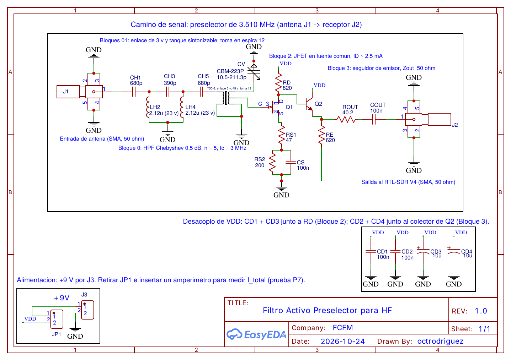
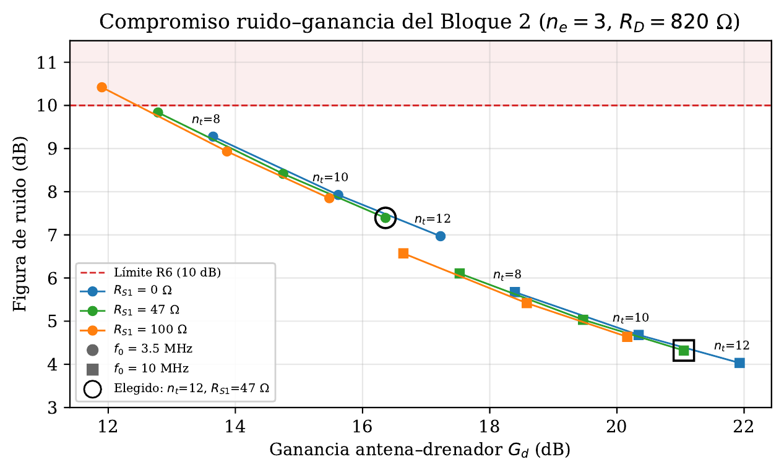
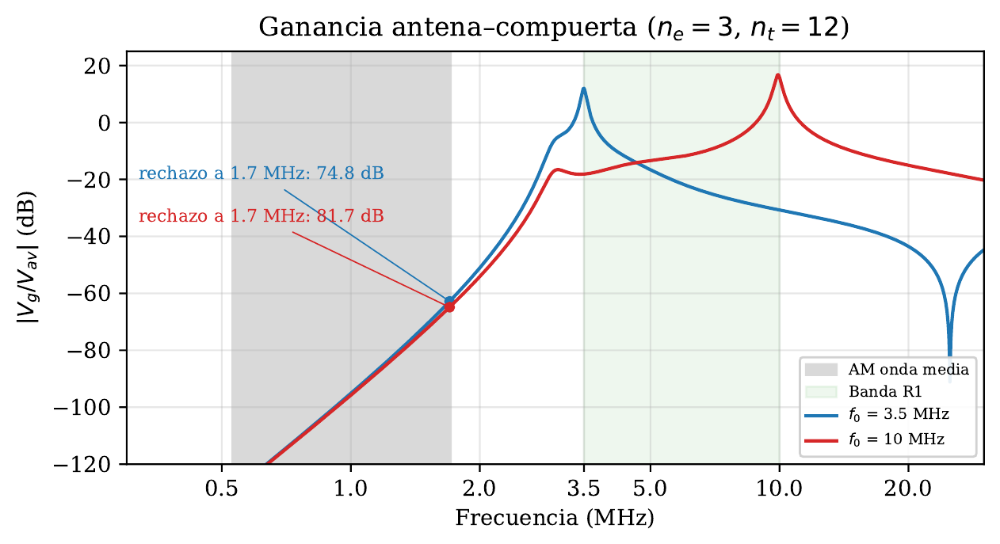
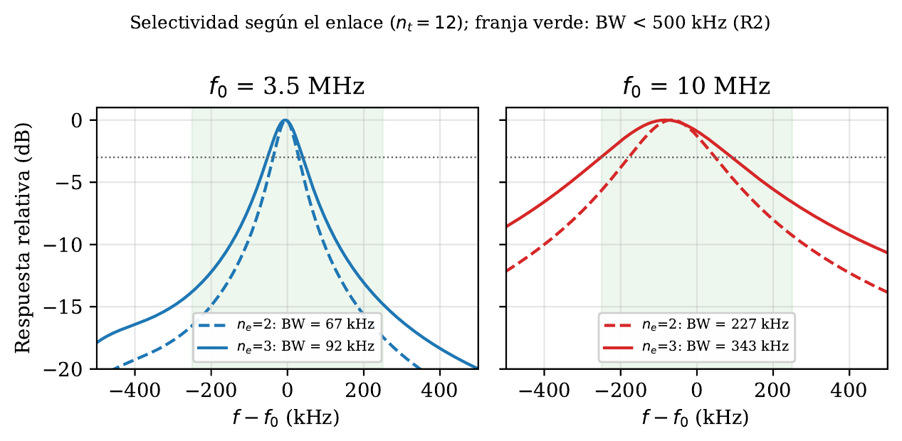

[← Back to home](/)

# Active HF Preselector

A tunable 3.5–10 MHz bandpass preselector that keeps strong medium-wave AM broadcast stations out of a low-cost software-defined radio (RTL-SDR V4).

**Status:** design and simulation complete; no PCB layout, not built or measured. All results below are LTspice simulations. 
**Course:** EL3202 Analog Electrical Circuits, Universidad de Chile (FCFM), Spring 2026. Individual elective lab project, supervised by Prof. Pablo Martín G. 
**Tools:** LTspice 26 (simulation), EasyEDA (schematic), Python (figures), LaTeX (reports).

## Motivation

In the HF band, useful ionospheric signals can be only a few µV at the antenna, while local medium-wave AM stations (0.53–1.71 MHz) can induce hundreds of mV. The 8-bit ADC of a low-cost SDR has a theoretical spurious-free dynamic range of about 50 dB [11], so these stations saturate it. The resulting clipping and intermodulation products land on top of weak signals and cannot be removed afterwards by digital signal processing.

The fix is analog: a tunable bandpass filter between the antenna and the 50 Ω input of the RTL-SDR V4 [1] that attenuates medium-wave AM before it reaches the ADC, and delivers the band of interest with moderate gain, low noise and a 50 Ω output.

## Approach

Report 1 reviewed five candidate topologies: N-path filters [2] (high out-of-band linearity, but they need a multiphase clock), common-base transformer-feedback amplifiers [3] (very high IIP3, but they need a toroidal transformer and provide no selectivity), gyrator-C active inductors (no coils, but noise figure above 10 dB), negative-resistance Q multipliers [4] (high Q, but risk of oscillation), and a plain LC tank followed by a JFET (simple and low-noise). The final design builds on the last one.

## Design overview

<svg viewBox="0 0 630 260" role="img" aria-label="Block diagram: antenna, Block 0 high-pass filter and link, Block 1 tuned LC tank, Block 2 common-source JFET, Block 3 emitter follower, RTL-SDR V4" style="width:100%;max-width:640px;height:auto;color:inherit;font-family:inherit">
<defs><marker id="arr" viewBox="0 0 10 10" refX="9" refY="5" markerWidth="7" markerHeight="7" orient="auto"><path d="M0,0 L10,5 L0,10 z" fill="currentColor"/></marker></defs>
<g fill="none" stroke="currentColor" stroke-width="1.6">
<rect x="15" y="20" width="170" height="80" rx="8" stroke-dasharray="5 4"/>
<rect x="230" y="20" width="170" height="80" rx="8"/>
<rect x="445" y="20" width="170" height="80" rx="8"/>
<rect x="15" y="160" width="170" height="80" rx="8"/>
<rect x="230" y="160" width="170" height="80" rx="8"/>
<rect x="445" y="160" width="170" height="80" rx="8" stroke-dasharray="5 4"/>
<line x1="185" y1="60" x2="228" y2="60" marker-end="url(#arr)"/>
<line x1="400" y1="60" x2="443" y2="60" marker-end="url(#arr)"/>
<polyline points="530,100 530,130 5,130 5,200 13,200" marker-end="url(#arr)"/>
<line x1="185" y1="200" x2="228" y2="200" marker-end="url(#arr)"/>
<line x1="400" y1="200" x2="443" y2="200" marker-end="url(#arr)"/>
</g>
<g fill="currentColor" font-size="15" text-anchor="middle">
<text x="100" y="55" font-weight="bold">Antenna</text><text x="100" y="77">50 Ω, SMA</text>
<text x="315" y="45" font-weight="bold">Block 0</text><text x="315" y="66">HPF, fc = 3 MHz</text><text x="315" y="86">+ 3-turn link</text>
<text x="530" y="45" font-weight="bold">Block 1</text><text x="530" y="66">Tuned LC tank</text><text x="530" y="86">T50-6 + CBM-223P</text>
<text x="100" y="185" font-weight="bold">Block 2</text><text x="100" y="206">Common-source</text><text x="100" y="226">JFET 2N5458</text>
<text x="315" y="185" font-weight="bold">Block 3</text><text x="315" y="206">Emitter follower</text><text x="315" y="226">BJT 2N3904</text>
<text x="530" y="195" font-weight="bold">RTL-SDR V4</text><text x="530" y="217">50 Ω, SMA</text>
</g>
</svg>

*Block diagram. The gate of the JFET is connected to a tap on the tank winding. Supply: 9 V, 12.5 mA total.*

- **Block 0, fixed high-pass filter and input link.** Fifth-order 0.5 dB Chebyshev high-pass, $$f_c = 3.0$$ MHz, T topology at 50 Ω [5]: 680 pF / 390 pF / 680 pF (C0G) in series and two 2.12 µH shunt inductors (23 turns on T50-6 cores [6]). Attenuation at 1.7 MHz: 35.3 dB nominal and 33.1 dB worst case in a ±5 % Monte Carlo analysis. A 3-turn link wound on the tank toroid transfers the signal to the tank (turns ratio $$N = 16.3$$, reflected source $$R'_s \approx 13.3$$ kΩ).
- **Block 1, tunable LC tank.** $$L_1$$: 49 turns of #28 AWG on a T50-6 core, 9.60 µH nominal (9.43 µH effective with coupling $$k = 0.95$$), tuned by a CBM-223P polyethylene variable capacitor with both sections in parallel (10.5–211.3 pF) [7]. Parasitic capacitance budget: $$C_{par} \le 12$$ pF. Unloaded $$Q_U \approx 75$$ (conservative estimate).
- **Block 2, common-source JFET.** 2N5458 [8], gate on a tap at turn 12 of $$L_1$$ ($$p = 0.245$$), with no bias resistor. $$R_D = 820\ \Omega$$, $$R_{S1} = 47\ \Omega$$ unbypassed and $$R_{S2} = 200\ \Omega$$ bypassed by 100 nF. Square-law bias [12]; operating point: $$I_D = 2.52$$ mA, $$\lvert A_v \rvert = 1.65$$.
- **Block 3, emitter follower.** 2N3904 [9], DC-coupled from the JFET drain, $$R_E = 620\ \Omega$$, $$I_E \approx 10$$ mA. A 40.2 Ω series resistor sets the 50 Ω output, and a 100 nF capacitor blocks the SDR's bias-tee voltage. Maximum output before clipping: +2.8 dBm into the 50 Ω load.

{: style="background:#fff;padding:8px;border-radius:6px;max-width:100%"}

*Full schematic (EasyEDA). Annotations are in Spanish, as in the original report.*

## Key design insight

The link and the gate tap split two decisions that were tied together in the first design. The number of link turns sets the loaded Q, and therefore the selectivity (R2). The tap position sets how much voltage and source resistance the JFET sees, and therefore the trade-off between noise and linearity (R5, R6).

Within the passband, the coupling network cannot improve both at once. With $$R_g$$ the source resistance seen by the gate, $$R_n$$ the equivalent noise resistance of the JFET stage, $$V_{IP3,g}$$ its third-order intercept voltage at the gate and $$F_{tank}$$ the noise factor added by the tank losses:

$$\frac{\mathrm{IIP3}_{ant}}{F/F_{tank} - 1} = \frac{V_{IP3,g}^2}{8 R_n}$$

The right-hand side depends only on the active device: the coupling network only chooses a point on the trade-off. This is why the linearity requirement was specified out of band, where the high-pass filter and the tank attenuate the interferers before they reach the transistor.

{: style="background:#fff;padding:8px;border-radius:6px;max-width:100%"}

*Noise figure versus antenna-to-drain gain for each tap position $$n_t$$ and unbypassed source resistance $$R_{S1}$$; circles at $$f_0 = 3.5$$ MHz, squares at 10 MHz. All points fall on one trade-off line; the chosen point ($$n_t = 12$$, $$R_{S1} = 47\ \Omega$$) is marked. Labels in Spanish.*

## Design evolution

The first version (Report 1) used a 10 pF series input capacitor, a Q multiplier (BJT Colpitts negative resistance), a 2N3819 JFET and a buffer. In simulation it failed two requirements: the noise figure was about 39 dB, because the 10 pF capacitor attenuated the signal by more than 30 dB before the first active stage, and the tuning range covered only 3.4–7.8 MHz.

The second version (Report 2) replaced the input capacitor with the high-pass filter and the link-and-tap coupling. This brought the noise figure down to 8.1 dB (worst case) and extended the tuning range to 3.46–10.82 MHz. The JFET was changed to a 2N5458.

The Q multiplier was removed for four reasons:

- **Not needed.** The link-coupled tank meets R2 on its own.
- **Not stable across the band with a fixed setting.** The negative resistance scales as $$R_{neg} \propto 1/\omega^2$$ while the tank loss resistance scales as $$R_p \propto \omega$$, so a setting at the edge of oscillation at one end of the band is overdamped or oscillating at the other.
- **Worse linearity.** The negative resistance depends on the transistor's $$g_m$$, so strong signals change the tank Q.
- **Added complexity.** One transistor, one potentiometer and a delicate adjustment fewer.

## Simulation results

All requirements refer to a 50 Ω source at the antenna terminal and a 50 Ω load at the output.

| ID | Requirement | Result (LTspice) |
|---|---|---|
| R1 | Tuning range $$3.5 \le f_0 \le 10$$ MHz | 3.46–10.82 MHz, nominal (about 1 % margin at the low end; $$L_1$$ trimming needed) |
| R2 | −3 dB bandwidth < 500 kHz and rejection ≥ 30 dB over 0.53–1.71 MHz, relative to $$\lvert H(f_0) \rvert$$ | 92 kHz at 3.5 MHz, 357 kHz at 10 MHz; rejection at 1.7 MHz 74.7 dB (worst case, $$f_0$$ = 3.5 MHz) |
| R3 | Transducer gain $$G_T = \lvert 2V_{out}/V_s \rvert^2 \ge 0$$ dB at $$f_0$$ (equivalent to $$\lvert S_{21} \rvert^2$$) | +10.5 dB at 3.5 MHz, +14.4 dB at 10 MHz |
| R4 | $$\lvert Z_{out} \rvert = 50\ \Omega \pm 10\,\%$$ in the passband | 46.8 Ω at 3.5 MHz, 53.3 Ω at 10 MHz |
| R5 | Out-of-band $$\mathrm{IIP3}_{OOB} > +15$$ dBm referred to the antenna terminal; tones at 1.0 and 1.5 MHz, product $$2f_1 + f_2$$ at $$f_0$$ = 3.5 MHz | Product below the simulator's numerical floor: a bound of > +130 dBm, **with no physical meaning** (see Limitations) |
| R6 | NF < 10 dB, referred to a 50 Ω source | 8.1 dB at 3.5 MHz, 4.9 dB at 10 MHz |
| R7 | $$V_{DD}$$ = 9 V, $$I_{total}$$ < 20 mA | 12.5 mA |

Changes to the requirements between reports: R2 added the medium-wave rejection; R3 defined the reference plane (transducer gain with 50 Ω source and load); R5 changed from in-band IIP3 to out-of-band IIP3, with the instructor's approval.

{: style="background:#fff;padding:8px;border-radius:6px;max-width:100%"}

*Voltage gain from the available source voltage to the JFET gate ($$n_e = 3$$, $$n_t = 12$$) for $$f_0$$ = 3.5 and 10 MHz. Grey: medium-wave AM band; green: tuning range (R1). Labels in Spanish.*

{: style="background:#fff;padding:8px;border-radius:6px;max-width:100%"}

*Response relative to the peak around $$f_0$$ for 2 and 3 link turns; the green band marks the 500 kHz limit of R2. Bandwidth grows roughly as $$f_0^2$$. Labels in Spanish.*

## Limitations

- **R1** depends on the parasitic capacitance $$C_{par}$$ and on the tolerance of the CBM-223P; with the worst-case minimum capacitance, the upper end falls below 10 MHz unless $$L_1$$ is trimmed.
- **R5** is a numerical bound, not a measurement or a physical IIP3. The square-law JFET model underestimates third-order intermodulation, and the second-order product $$f_1 + f_2$$ of two medium-wave stations (up to 3.42 MHz) is not covered by any requirement.
- The design assumes a resistive 50 Ω source; the intended antenna (a passive magnetic loop) is not.
- Tuning is manual, and the bandwidth grows roughly as $$f_0^2$$.
- All results depend on SPICE models; there is no experimental validation.

## Proposed test plan

Report 2 defines eight tests, P0–P7, each linked to a requirement: bias point, tuning range, selectivity, gain, output impedance, out-of-band IIP3 with a resistive two-tone combiner, noise figure by the gain method with the Friis formula [10], using the RTL-SDR as a calibrated power meter, and supply current. **These tests were proposed but not performed.**

## Future work

- PCB layout and fabrication (estimated cost of the parts to buy: about CLP 28,564).
- Measurements P0–P7 against the simulated values.
- Second-order intermodulation (IIP2) characterization.
- Powering from the RTL-SDR bias tee.
- Integration with the RTL-SDR V4 and a magnetic loop antenna.

## Downloads

- [Report 2: final design (PDF, in Spanish)](hf-preselector-report-2-es.pdf). Datasheet appendix removed; see the links in the references.
- [Report 1: problem and proposed solution, first design (PDF, in Spanish)](hf-preselector-report-1-es.pdf)
- [Schematic (PNG)](schematic.png)

## References

1. RTL-SDR Blog, "RTL-SDR Blog V4 datasheet," V1.0, 2024. [Online]. Available: <https://www.rtl-sdr.com/wp-content/uploads/2024/12/RTLSDR_V4_Datasheet_V_1_0.pdf>
2. A. Ghaffari, E. A. M. Klumperink, M. C. M. Soer, and B. Nauta, "Tunable high-Q N-path band-pass filters: Modeling and verification," *IEEE J. Solid-State Circuits*, vol. 46, no. 5, pp. 998–1010, May 2011.
3. D. Lankford, "Common base transformer feedback Norton amplifiers," rev. May 2007. [Online]. Available: <http://www.thegleam.com/ke5fx/norton/lankford.pdf>
4. B. Razavi, *RF Microelectronics*, 2nd ed. Upper Saddle River, NJ, USA: Prentice Hall, 2012.
5. D. M. Pozar, *Microwave Engineering*, 4th ed. Hoboken, NJ, USA: Wiley, 2012.
6. Micrometals, Inc., "T50-6 iron powder core," datasheet, rev. 20190524, May 2019. [Online]. Available: <https://www.rf-microwave.com/resources/products_attachments/6129009a4395b.pdf>
7. Hong Da Industrial (HK) Ltd., "CBM-223P polythene variable capacitor," product specification. [Online]. Available: <https://www.hdic.com.hk/?topclassid=11&classid=204&id=761>
8. Calogic Corp., "2N5457–2N5459 N-channel JFET general purpose amplifier/switch," datasheet. [Online]. Available: <https://www.alldatasheet.es/datasheet-pdf/pdf/57108/CALOGIC/2N5458.html>
9. Philips Semiconductors, "2N3904 NPN switching transistor," product specification, Apr. 1999. [Online]. Available: <https://www.alldatasheet.com/datasheet-pdf/view/15077/PHILIPS/2N3904.html>
10. H. T. Friis, "Noise figures of radio receivers," *Proc. IRE*, vol. 32, no. 7, pp. 419–422, Jul. 1944.
11. T. F. Collins, R. Getz, D. Pu, and A. M. Wyglinski, *Software-Defined Radio for Engineers*. Norwood, MA, USA: Artech House, 2018.
12. A. S. Sedra, K. C. Smith, T. C. Carusone, and V. Gaudet, *Microelectronic Circuits*, 8th ed. New York, NY, USA: Oxford University Press, 2020.

## Use of AI tools

The author used generative AI tools as support in preparing the report. In particular, these tools were used to help review and improve wording and style, format the document in LaTeX (including layout and tables), review theoretical concepts and bibliographic references, check calculations and numerical results, write scripts for figures, and review the structure and coherence of the report. The author reviewed and edited the generated content, verified the calculations, references and results presented, and takes responsibility for the design decisions and the final content.

---

Text and figures on this page are licensed under [CC BY 4.0](https://creativecommons.org/licenses/by/4.0/). Contact: octavio (dot) rodriguez (at) ing (dot) uchile (dot) cl

